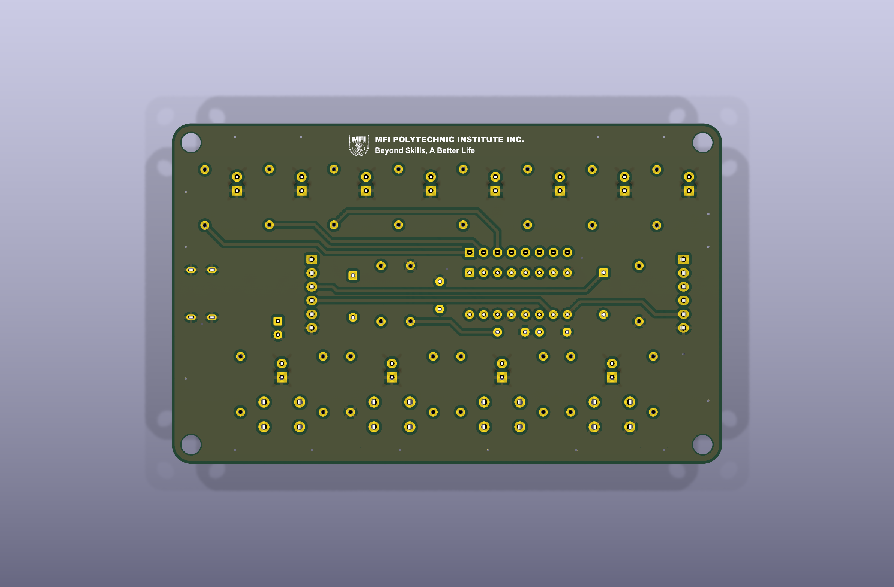

# 74HC595 Module

An 8-bit SIPO (Serial-In, Parallel-Out) shift register board for learning how the 74HC595 works.
**DATA IN**, **CLOCK**, **LATCH** and **CLEAR** are entered by hand with push buttons, and the eight outputs are shown on LEDs.
Boards can be chained through 6-Pin JST-XH connectors.

## Features
- 74HC595 (optional DIP-16 socket)
- 4 push buttons: **DATA IN**, **CLOCK**, **LATCH**, **CLEAR**, each with an indicator LED
- 8 output LEDs (O1–O8) plus a 01×08 header for the outputs
- USB-C 5V input (Power only) with a 0.5 A resettable PTC fuse and reverse-polarity clamp
- Chain IN / OUT on 6-Pin JST-XH: **+5V**, **RCLK**, **SRCLK**, **SRCLR**, **SER_IN/Q8'**, **GND**

## Specifications
| | |
|---|---|
| Board size | 100×62 mm, 04×M3 mounting holes |
| Layers | 2, GND pour on both sides |
| Supply | 5 V via USB-C, about 90 mA max per board |
<!-- | Min track / clearance | 0.2 mm / 0.2 mm | -->

## Repository contents
| Files / Folders | Description |
|---|---|
| [`74HC595-module.kicad_pro`](74HC595-module.kicad_pro) | KiCad 10 project (open this to open the entire project) |
| [`74HC595-module.kicad_sch`](74HC595-module.kicad_sch) | KiCad 10 schematic (open this to view only the schematic) |
| [`74HC595-module.kicad_pcb`](74HC595-module.kicad_pcb) | KiCad 10 pcb (open this to view only the pcb) |
| [`gerber/`](gerber/) | Gerber and drill files for manufacturing |
| [`documentation/`](documentation/) | Schematic PDF, Board Layout PDF, BOM, 3D Renders and GLB Model |
| [`3dmodels/`](3dmodels/) | Custom 3D models used by the board (Banded resistors, USB-C, Resettable PTC fuse) |

## Ordering the PCB
1. Zip the contents of [`gerber/`](gerber/).
2. Upload it to a PCB fab (e.g. JLCPCB or PCBWay).
3. Options: 2 layers, 1.6 mm FR-4, **HASL lead-free** finish, any solder mask colour.

## Assembly
- Parts list: [`documentation/74HC595-module-BOM.csv`](documentation/74HC595-module-BOM.csv)
- The IC can be soldered directly to the board or you can also buy a **DIP-16 IC socket**, which isn't listed in the BOM.
- Solder the SMD parts first (J1 USB-C, F1, D1, D2, R1–R3, C1), then the through-hole parts from lowest to tallest.
- Check polarity on the diodes, LEDs and C2.

## How to use
1. Plug in USB-C. The green power LED (D2) should light up.
2. While holding **DATA IN** (1) or leaving it released (0), press **CLOCK** to shift the bit to the shift register. Repeat shifting bits as desired.
3. Press **LATCH** to store the shifted bits to the output register (O1–O8).
4. Press **CLEAR** to reset the shift register, then press **LATCH** to clear the output register.

## Built with
KiCad 10.0

## License
This project is licensed under the
[Creative Commons Attribution-ShareAlike 4.0 International License (CC BY-SA 4.0)](https://creativecommons.org/licenses/by-sa/4.0/).
See [`LICENSE`](LICENSE).

You may share and adapt the design, including commercially, as long as you give credit
and release your changes under the same license.

## Author
**Adrian Christian Yap**, MFI Polytechnic Institute
