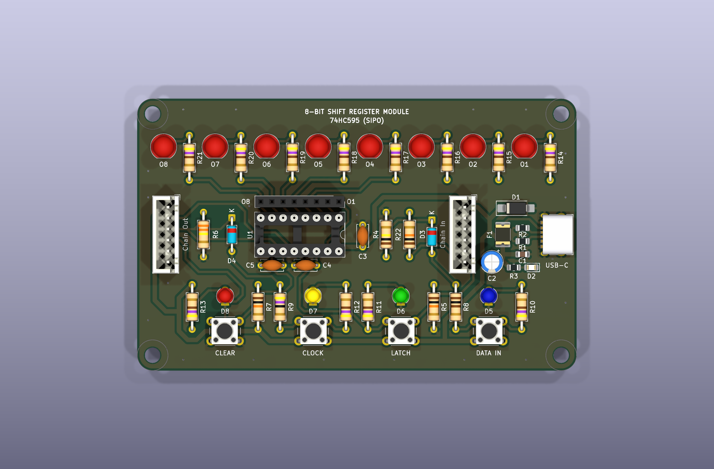

<h1 align="center">74HC595 Module</h1>

An 8-bit SIPO (Serial-In, Parallel-Out) shift register board for learning how the 74HC595 works.
**DATA IN**, **CLOCK**, **LATCH** and **CLEAR** are entered by hand with push buttons, and the eight outputs are shown on LEDs.
Boards can be chained through 6-Pin JST-XH connectors.

## Features
- 74HC595 (optional DIP-16 socket)
- 4 push buttons: **DATA IN**, **CLOCK**, **LATCH**, **CLEAR**, each with an indicator LED
- 8 output LEDs (O1–O8) plus a 01×08 header for the outputs
- USB-C 5V input (Power only) with a 0.5 A resettable PTC fuse and reverse-polarity clamp
- Chain IN / OUT on 6-Pin JST-XH: **+5V**, **RCLK**, **SRCLK**, **SRCLR**, **SER_IN/Q8'**, **GND**

## Specifications
| Specification | Description |
|---|---|
| Board size | 100×62 mm, 04×M3 mounting holes |
| Layers | 2, GND pour on both sides |
| Power | 5V via USB-C, about 90 mA max per board |

## 3D View

## Repository contents
| Files / Folders | Description |
|---|---|
| [`74HC595-module.kicad_pro`](74HC595-module.kicad_pro) | KiCad 10 project (open this to open the entire project) |
| [`74HC595-module.kicad_sch`](74HC595-module.kicad_sch) | KiCad 10 schematic (open this to view only the schematic) |
| [`74HC595-module.kicad_pcb`](74HC595-module.kicad_pcb) | KiCad 10 pcb (open this to view only the pcb) |
| [`gerber/`](gerber/) | Gerber and drill files for manufacturing |
| [`documentation/`](documentation/) | Schematic PDF, Board Layout PDF, BOM, 3D Renders and GLB Model |
| [`3dmodels/`](3dmodels/) | Custom 3D models used by the board (Banded resistors, USB-C, Resettable PTC fuse) |

## Ordering the PCB
1. Zip the contents of [`gerber/`](gerber/) or download the Gerber zip from the [latest release](https://github.com/engadrianchristian-ctrl/74HC595-module/releases/latest).
2. Upload it to a PCB fab (e.g. JLCPCB or PCBWay).
3. Options: 2 layers, 1.6 mm FR-4, HASL lead-free finish, any solder mask colour.

## Assembly
- Parts list: [`documentation/74HC595-module-BOM.csv`](documentation/74HC595-module-BOM.csv)
- The IC can be soldered directly to the board or you can also buy a **DIP-16 IC socket**, which isn't listed in the BOM.
- Solder the SMD parts first (J1 USB-C, F1, D1, D2, R1–R3, C1), then the through-hole parts from lowest to tallest.
- Check polarity on the diodes, LEDs and C2.

## How to use
1. Plug in USB-C. The green power LED (D2) should light up.
2. While holding **DATA IN** (1) or leaving it released (0), press **CLOCK** to shift the bit to the shift register. Repeat shifting bits as desired.
3. Press **LATCH** to store the shifted bits to the output register (O1–O8).
4. Press **CLEAR** to reset the shift register, then press **LATCH** to clear the output register.

## Built with
KiCad 10.0

## License
This work, including the KiCad design files, Gerber and drill files,
documentation, renders and 3D models in this repository, is licensed under the
Creative Commons Attribution-ShareAlike 4.0 International License (CC BY-SA 4.0).

You are free to:
  Share  - copy and redistribute the material in any medium or format
  Adapt  - remix, transform, and build upon the material for any purpose,
           even commercially.

Under the following terms:
  Attribution - You must give appropriate credit, provide a link to the
                license, and indicate if changes were made.
  ShareAlike  - If you remix, transform, or build upon the material, you must
                distribute your contributions under the same license as the
                original.

You may share and adapt the design, including commercially, as long as you give credit
and release your changes under the same license.

The full legal code is available at:
https://creativecommons.org/licenses/by-sa/4.0/legalcode

## Author

  <b>Adrian Christian Yap: </b>
  

  <b>MFI Polytechnic Institute: </b>
  <a href="https://www.mfi.edu.ph/"><img alt="MFI Website" src="[https://img.shields.io/badge/LinkedIn-0A66C2?style=for-the-badge](https://img.shields.io/badge/MFI_Polytechnic_Institute_Inc-1B3A8C?style=for-the-badge&logo=%2B04JVazKWoCIsoMgFir7DvWbUx8RpTQzMccz%2F3Pu%2Bc577757f3Xf%2B%2Bq9TyQStG%2Fqgnn%2BKxZ9FLhqkVbAyk%2B1Alaqn49N3dbs%2B7%2Fsp%2Fwf9z%2BOqen3iVbIKtFrpn8b4xK9%2F%2BqO768W28dLORQSwqEQsWCHf3y%2BqP2ceT%2FtE4plbAImJ6PbRCKDqSKRaO0fTOzDuqxu%2B5Bx%2Fwbp9%2FMnWE57ESWD5RQPlAlPdfvxWEGvYnysqK8U%2BYNCivrLhPbTVjJQRmFfKdmPisbj5HUWP5NLpizArsqPA15iJosctEQikc4UfYsrbRFN13ie2poHSIyrRppcJzw7lEPjY4oCJUnxNaQm1ZIla2KkF2TXGoW2NKVu3FKSasnLahbmqscS4qqpr%2BqckOex0pQ30HO8zB9ELu8LcIZn%2FduC65M1%2FQT5BhYwaZoZ0%2BZa85tpZpy1kwr9fX1D%2FGOpO1P%2BasGbs87y4RJXihV3mf2JI1NnW%2FHWe5ZMesecSe%2BY8as3TZn3mRNhUQr%2BOMuS194%2BhblVimYqQbEtmRg4%2Bfw8uCBJMdPmWDHnUyf%2BNN%2BGNVsChf7i0mb%2B8qEd7y10ZNbf7VnyjSel5S0sXO7OXz6yE9pnbKWCmVml4OaVQ1JaJe9%2BZCfAWzuma6YS9MJw6sosXXGJL77xEiDVVQsILeKP%2F2bJah1%2Foe%2Fzp%2BDenmON3u4wzVDIsmuZoWXzcuGmvGvB%2Bm3BHDSN4%2FUZp5Fl1XDwZLxQOXWSWX934POvn8D9dYE9C5dfYNuuMLbuDGPt1iCKFc0Ultx9%2BXCT1XB6wYgjFMIe238shmUrvVm%2B6jJRceX8eb7NBDj1Uqv33swPbAV7Y%2BZpkqV3hPGXDjfl3TOs0vHnTpWS%2BYtcmL3Qkenvn%2BOwWQK5NxqEZXwabvq8c6zdGkhjUzsNTe3UNTyiv3%2BYzJw6Znxgy9Q5LxFOXbmv1%2FoyODjMCu0rzPjAhrdmWyGOVFBY0ixU4mm4aXOs2Wws1gxFRtZL3nNXQgp59W0z4WVQ66RlirDv3nnfmtr6h2Tn1Qvtfyxzp6S0Ga3FLsKPUe8zTV2T1wgv0eszz3DGJk1zWNALwcUlV%2FLJlxcw2BshtGXZdXz21UV0jcYqo67c4v%2FyQMdITFV1mwClruIR80SNSGO%2By1Z5C%2BNeftc1hwU9Fy6kPhmVCvr7B%2BnrHRCeauvp6Ud5v4OO9h6Gh0fo6Oimr2%2BQwcGxk0Lt09vTL4wPDAwJPurl7%2Bzspb29h66uPtrbu4U4amtr6xR81T6DA2MxhoaG6ejo%2BWk4SVMqowMqLE4HERx0jYvusQQFSAkNSSciTI6HeywuTpFkpCs47xqNt1ciHhfi8PJMwNsrgcaG%2ByQn5ePmHInv5WT8%2FVIFCwqU4uuTjM%2FlZMIlmUKfu1s0FTcb8PVJwd0tBleXKAoLqlCNqohvzXoWTtyYynDfCPk3blNUWEX6NQXStGLKy%2BqpqW4hU15GcmIBhQV3yL9%2Biyx5GaV5FRRmlyOXFtPT%2BoBbpTUUZZZSlHuTkvzbNFU2UFFaS21NM0WFdyguqqaiokGIXV%2FfiiyjlKzMm0JbnXewd5gEZfazcD%2B1554nmayahmolBV0qxI39PBgB65J2KrtG8ajqRdE5St7DIa7U9aFs7yMl%2Fib9g5pRnq%2FnLuvPgRsZBefz2ZwPUbBT1sqUK3X4VXayJb2VX3vXIKnuQyu8iffE9SQ09DBX0sDi2LvYJddhah5LfVO3Zshn9IvhPLzlBB7VZl1gBq8EKdFLbyWspkuAXBjZjEGqB8tjb%2FLGlQYO57Xhe6uD1wKa0fItId5mPdbmF2l9OKIZdoJ%2BEVxUYg2BlrugQJuLlvr8zrOGwNo%2B1qbeY7J%2FK%2F8R28DcK9%2ByLCaD6cGPmBncSGxjL7PD2zhu%2Fj1kb6AieAs2drGMqjSjP9ELw6l%2F7bmTdgzLdBnMNmYgbg2HrK2JvQdrUppYnSBnY5qSryJN0Umr4NukAtam3MavEVz8gmgKXsVQ9g64sY2Qc7tJljVpphiXBtyqyYZn%2FJWBdUmafuMKClMg99CDPAN60o0YyTGm2X8VccnplHTC9lQbFoTsJSvPD8MEKxZLjCnqGCYqp4Jq77WocgzpyTBiQG7Eo0RdbK0DGBrVzDKmmBY5BsJN2H2uAGdk4a8MrH8%2B3OAIOJ27THfqJvpkRvRmjBk5eohtDdgYIWFrmh0bk2044r8No%2FjT7MpwYV2cGHdrE1QZuvTJtj%2BZd30bflaHUVR2aaYSFNsix9DJh38Zq9xnkwx%2BCLjrXR2r6SeoqnGAy9anIHerULV%2B%2BXYGs4zplxszlKCNhZMZk303Mj%2FIkPg0dzZHmzHJ%2B2v2uJyiK2IDQ%2BptkLldMPV8Va4Bck8Drsbd1EwlKLxJipG9z7BIZDv2ebj9RKjCpWLs7NRUdoGSCMf9kKcnALXFbeGuZO3YHso1JP38Vr4KvM68CHtMQnRYJD7KF%2BE5SBx2Q%2FY2BrN20BalTWukDgOZxgxlGnIrZAtX%2FGWaqQT51sRhbBnwUL2iApzBzqthZ%2FND6RwaO9%2BeljSzkQTXnZCrz3C2IQW%2B24m2P0hf0kYGc3YykrYeW4uDhDVAQoQb0vp%2BrB2caI9azVDOTgakusQ67OHahV0MZ%2BozmGlIfcQmLl169mKgQoVDuQTjo5LCHz%2BqRaIVX4r3HE%2BQcP1BmaY%2FstwWYpz3QJ4%2BqoxNODidZH6oEjcLQ5Bp0xyznaoUXy45S9Bfb4SjuSt3UkOpj9oDWZuQOmkz37%2BOvY6ujCSvZyjLiGrJZnx8nr0y1XU3Y5YZypZNUa7jcK%2BLzGeZOIWOeNdEafqjqOwm0OYo5G2DHH1CnAx49fJd9sZVUnRRl3I%2FPe7XVXLZ%2FAek4W74njKhobKcSslhZM4rCJYW8KfIXqxsDoB8M6M5huT76hEaXqiZivDGNI4EhKP1rueX43BqGRpFJprfCOJur3LCBPVNxtXSiWGZOvB2bl9Zx3RbKfsrICm3Bp1lG3DdqU1eXCQ5MY7E%2Blwg7Mxu9Jet5ohNLBEd8La7gvSLupCrflv1iHDYgyyvdUKe3uF%2BzioC2H00slIkEv16AtzcP7suOeEbzfnbkgmT1LromUZlyGZGc40YiFvHBktXDper6GofYPmaEEKiq7lTdQ%2Fnrb%2FH39Wah72wZGUgxWX3ye%2BDlU4S7oV%2Bx1CWMcOyTTicduZR98RjIqQuiVNR0Sz91F9vAthjbdGNCDfPEZPZWjxhYsmtTjxOH4HrWxjJMqDIU5eLWfWoa2zhlIH%2B7nDBLzEympamJqTyOhZ9dQFlv4rIqi7S3HcwLNsq%2FIlneW7DN2jikt7uqOdUvj8798WqX4RfaXL9KKNph8zjlSeKvKntvDshgMuFdPIvb4Z8Q0bSNmJ8dA%2Fi%2BgG8vG%2FwxdceWNhJyStqQxJdwX9v8MXwYCxlzSOcdrCmLXINo7nG9KTpcsbUlbaOJ8dD%2B0AXp0q8OOGcMPzmb60XaBJN0N%2BmOiw96ZY0alrsSUP3vfEgD7tU%2FHDSm6ZIHSjYTnvMOlIvHsKvuJmT17tYtsQJo91hLP7ckYOuN9hR0E3KZQuUYd%2FBdWNUWbo4HD9GZv6TPd052MMPpZewCEph8QJvfU2W5%2Brj2Rd0zD2SMS32orCtcjxYTdMAZscucitYF4oNUEm1uWqvwwrfLPYnNFPRMYiPohPtwCKcLbfTE7cGiozoTtXF8fhRYlLqxmPVdjZjpriEpTiV%2F%2Fx3%2F%2BOaDP%2Br5sx0%2Fc7UPrlbvReCaxMZHh27h7UoR7E6F4nYZhddaZshT5vos6t5y0WOa8MI%2F4y8jYOpLsjXCUdepuc2LExdkeU9qVhcUyaninww80jki4W%2B%2BzRz%2F0wd%2FXDv94k3ziTFcLbMj7SWJ59zaektONv6Y3fABLeDx7B1uERqYy8XfCNxNjmE44E9uFk6EhhcwlDf2Jw8ZRk2N%2F05nR7BwVNJ1e%2B8YTvx%2F%2BwX6JVvvpQcO3wu7oF5WgTWZYGEN6Zwd6SZ3hG4fWeApNjbxEvKiA%2B%2FRYy4nMhQBYWF7Sg7VdxXPSD%2Bngzbm0GYyyQccYruX%2F9tpININHPs7Hw5%2Bnba2pVRJ03MYyoP%2BooxvybGXiHBvzGOuHY5qR25pDzIJrU9h4SOLEJaknAuD%2BO0PJQjQRJMzkY1bdoQYy8SHXhPM%2FLL1Cuzp3sv3bghysr4%2B6tpu86ENux2COrddz6A%2FR6B7LsQyG6HwP6dFqHNxociMrdsinH6eM6Vf4pE%2F%2Fp7zUD%2FH%2FqNSHRi%2BhSR47wZv3X7%2BC2Rm5ZIZD5DJPrgd5qOL6r%2FAT6nUGQPqz1iAAAAAElFTkSuQmCC)"></a>
  

